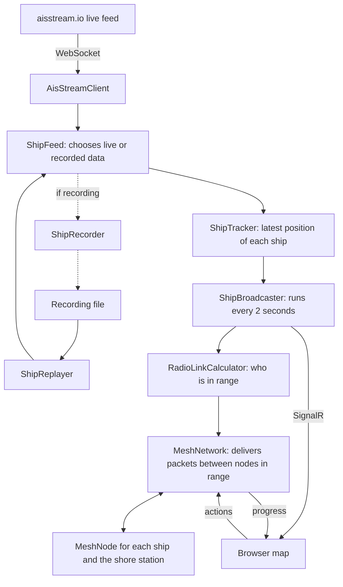

# Ship Mesh Simulator

A live map of real ships in the Port of Hamburg that asks: if these ships had mesh radios, how would the network behave?

Each ship acts as an independent network node. Ships pass messages to a shore station one hop at a time, and if a ship fails, the others find another route by themselves.

Built with C#, ASP.NET Core, SignalR, Leaflet, and OpenStreetMap.

## What's real and what's simulated

This project simulates the network. It doesn't use real radios, and these ships aren't really connected to each other.

| Part | Status |
|---|---|
| Ship names, MMSI numbers, positions, speeds, and courses | **Real**, from live AIS reports through [aisstream.io](https://aisstream.io) or a recording of them |
| Which ships are in range | **Calculated** from real distances and a chosen radio range |
| Signal strength | **Simulated** with a simple formula based on distance |
| Messages and routing | **Simulated**, but they do pass from node to node using the logic in this project |
| Ship failures | **Simulated** with the "Kill node" button |

## What you can do

- Watch ships move and see simulated radio links appear and disappear
- Select a ship to see its current route to shore
- Send a message and watch it travel hop by hop
- Kill a ship, even while a message is on its way, and see the network recover
- Switch between live data and a recording

The page works on laptops, tablets, and phones.

## How it works



### How ships find a route

No central program chooses the route. Each `MeshNode` has its own inbox and knows only what its neighbors tell it. This is a simplified form of distance-vector routing:

1. Once a second, the shore station tells nodes in range that it's 0 hops from shore.
2. A ship that hears this knows it's 1 hop away and tells its own neighbors, so the information spreads outward.
3. Each ship sends messages to the neighbor closest to shore. If two tie, it uses the stronger signal.
4. A ship ignores any neighbor that's routing through it, which helps prevent loops. Routes over 12 hops are ignored too, so routes can't grow forever.

### How the network recovers

- **A neighbor goes quiet:** after 3 seconds of silence, a ship forgets that neighbor and uses another one.
- **A message can't be sent:** the ship immediately tries its next-best neighbor.
- **The next ship disappears mid-delivery:** the sender gets the message back and tries another route.
- **The live feed fails:** the app keeps reconnecting, and after 60 seconds of silence it switches to the recording if there is one.

## Run it

You need the [.NET 10 SDK](https://dotnet.microsoft.com/download). For live data, you also need a free [aisstream.io](https://aisstream.io) API key.

Save your key privately. This stores it outside the project, so it can't be committed:

```
dotnet user-secrets set "AisStream:ApiKey" "YOUR_KEY"
```

Start the app, then open <http://localhost:5000>. Press `Ctrl+C` in the terminal to stop it.

```
dotnet run
```

Moored ships report only every few minutes, so give the map about 5 minutes to fill up.

## Record and replay ship data

The app switches to a recording if the live feed is silent for a minute or if there's no API key. You can also switch by hand on the page. Replayed data is clearly labeled.

To make a recording from the live feed, run this and leave it for 15 minutes:

```
dotnet run -- --Recording:Enabled=true
```

The file is saved in `recordings/` only once the 15 minutes are up, so stopping early keeps any previous recording. Recordings aren't included in this repository.

## Run the tests

```
dotnet test tests
```

The tests cover distance and link calculations, ship tracking, and routing. The routing tests run real `MeshNode` objects on small made-up networks, including killed nodes and failed deliveries.

## Settings

These are in `appsettings.json`:

| Setting | What it does |
|---|---|
| `AisStream:MinLatitude`, `MinLongitude`, `MaxLatitude`, `MaxLongitude` | The map area to get ships from |
| `Mesh:RadioRangeKm` | How far apart two nodes can be and still connect |
| `Mesh:HopDelayMilliseconds` | How long a message takes to cross one link, so it can be seen |
| `Mesh:ShoreLatitude`, `ShoreLongitude` | Where the shore station is |
| `Tracking:MaxShipsOnMap` | The most ships to include in the map and mesh |
| `Tracking:StaleAfterMinutes` | How long before a silent ship is removed |

## Known limits

- **It's an emulation:** there are no radio signals, interference, or real network protocols, and hop delay is a fixed value.
- **Viewers share one network:** if one person kills a ship, every open page sees it. This would need to change before putting the app online for several people.
- **There's one shore station:** a second one would give cut-off groups of ships another way out.
- **Replay restarts from the beginning:** ships jump back to their earlier positions when the recording starts over.

## How it was built

Claude, an AI assistant, wrote most of this code while I was learning C# and mesh networking concepts for a job application. I directed the project, tested it on real data, and studied the code.
